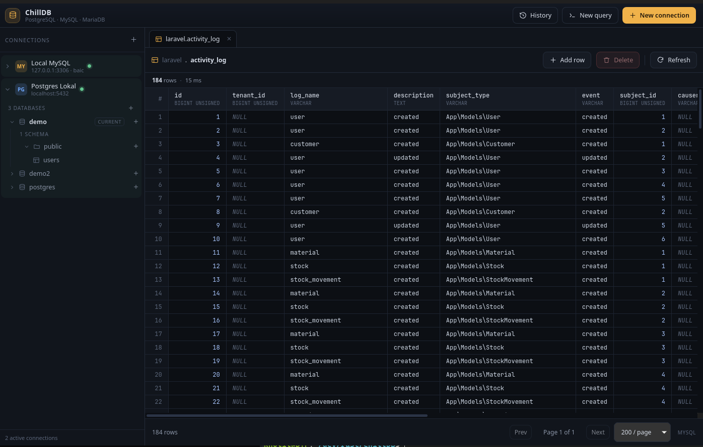

# ChillDB

[Support ChillDB on Buy Me a Coffee](https://buymeacoffee.com/amdkholil)

ChillDB is a small, fast desktop SQL client for PostgreSQL and MySQL/MariaDB.
It is built with Tauri 2, Rust, vanilla TypeScript, and Vite, with no frontend
framework and no ORM.



## Features

- Connect to PostgreSQL and MySQL/MariaDB, including optional SSH tunnels.
- Browse databases, schemas, tables, and views in a sidebar.
- Search tables in the active database directly from the sidebar.
- Open tables with pagination, primary-key ordering, and inline cell editing.
- Add, edit, and delete rows with NULL handling and primary-key safety.
- Structure tab for renaming tables, truncating tables, and adding, editing, or
  deleting columns.
- Create tables with an engine-aware column builder, including MySQL enums and
  PostgreSQL enum types.
- Create databases and PostgreSQL schemas, including schemas in another
  database on the same server.
- Switch PostgreSQL databases directly from the sidebar.
- Run single-statement SQL queries with typed results and execution history.
- Optionally save database and SSH secrets in the operating system credential
  store.

## Stack

- Tauri 2
- Rust with `sqlx` (PostgreSQL and MySQL)
- Vanilla TypeScript and Vite
- `ssh2` for SSH tunneling
- `keyring` for OS credential storage

## Requirements

- Node.js and npm
- Rust toolchain
- Tauri system dependencies for your platform
- On Linux, `libdbus-1-dev` and `pkg-config` for the credential store

## Development

```bash
npm ci
npm run tauri dev
```

On Linux, an X11 backend may be required:

```bash
GDK_BACKEND=x11 WEBKIT_DISABLE_COMPOSITING_MODE=1 LIBGL_ALWAYS_SOFTWARE=1 npm run tauri dev
```

Build the frontend and check the Rust backend:

```bash
npm run build
cargo check --manifest-path src-tauri/Cargo.toml
```

## Profiles and secrets

Profiles are stored outside the repository at
`~/.local/share/io.chilldb.desktop/connections.json` with mode `0600`. Passwords
are never written to this file. Opt-in saved passwords and SSH secrets are kept
in the OS credential store and deleted when **Save password** is unchecked or
the profile is removed.

## Error notifications

ChillDB can send application error reports to a Discord webhook. The URL is read
from `CHILLDB_DISCORD_WEBHOOK` or from
`~/.local/share/io.chilldb.desktop/discord-webhook` (mode `0600`). The webhook
URL is never written to the profile file, logs, or source control. Reports are
throttled and truncated.

## Releases

The version in `package.json` is the single source of truth. Run
`npm run version:check` before tagging. Pushing a `v*` tag builds Linux and
Windows installers and creates a draft GitHub release.

## Support

If ChillDB is useful to you, you can support development at
[buymeacoffee.com/amdkholil](https://buymeacoffee.com/amdkholil).
